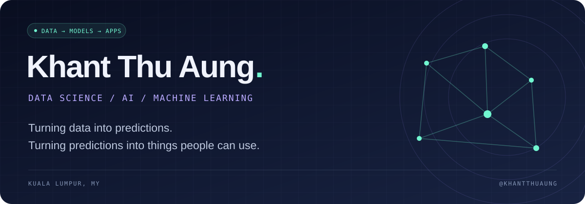

  

  &nbsp;
  &nbsp;
  

 

<h2 align="center">A little about the person behind the models</h2>

  I'm <b>Khant Thu Aung</b>, based in Kuala Lumpur. 
  I explore applied machine learning through code analysis, traffic forecasting, and computer vision. 
  I enjoy connecting the pieces: <b>prepare the data → compare the models → build the application.</b>

 

<h2 align="center">◆ &nbsp; Selected work &nbsp; ◆</h2>

<table>
<tr>
<td width="50%" valign="top">

### 01 &nbsp; Code Vulnerability Detection

**APPLIED ML · TEAM PROJECT**

From C/C++ source code to risk signals. A web app combining classical models, security features, and CodeBERT, with model comparisons and interactive visualizations.

`CodeBERT` `scikit-learn` `FastAPI` `React` `D3.js`

**[Explore the project ↗](https://github.com/RockyMoeHein/COS30049Assignment3)**

</td>
<td width="50%" valign="top">

### 02 &nbsp; Traffic & Route Intelligence

**TIME SERIES · TEAM PROJECT**

From sensor readings to route recommendations. Compares Random Forest, XGBoost, LSTM, and GRU forecasts, then uses estimated travel times and A* to plan routes.

`Python` `XGBoost` `LSTM / GRU` `A*` `React`

**[Explore the project ↗](https://github.com/RockyMoeHein/COS30019Assignment2b)**

</td>
</tr>
<tr>
<td width="50%" valign="top">

### 03 &nbsp; Rock, Paper, Neural Network

**COMPUTER VISION · IMAGE CLASSIFICATION**

Upload a hand-gesture image and let a Keras model classify it as rock, paper, or scissors, through a simple Streamlit interface.

`TensorFlow` `Keras` `NumPy` `Streamlit`

**[Explore the project ↗](https://github.com/khantthuaung/rps_predictor)**

</td>
<td width="50%" valign="top">

### 04 &nbsp; LoanPredict

**PREDICTIVE MODELING · PROTOTYPE**

An interactive model demo that transforms applicant information into numerical features and predicts a loan amount using a saved model.

`Python` `pandas` `NumPy` `Streamlit`

**[Explore the project ↗](https://github.com/khantthuaung/LoanPredict)**

</td>
</tr>
</table>

 

<h2 align="center">The toolkit</h2>

Technologies across my individual and team projects

  
  
  
  
  
  
  
  
  
  
  
  

 

<b>⌘ &nbsp; Outside the ML lab</b>

 

I also build games, web projects, and small tools that put data to work.

- **[Albion Market Tool](https://github.com/khantthuaung/albion-blackmarket-flipping)** — compares in-game market prices from an API and estimates trading margins.
- **[Tic-Tac-Toe](https://github.com/khantthuaung/tic-tac-toe)** — a Python take on the classic game.
- **[Fitness Gym](https://github.com/khantthuaung/fitnessgym)** — a university web development project.

 

  <b>Data. Curiosity. Code.</b>  
  <a href="https://khantthuaung.github.io/">Portfolio</a> &nbsp; / &nbsp;
  <a href="https://www.linkedin.com/in/0xkhantthuaung">LinkedIn</a> &nbsp; / &nbsp;
  <a href="https://github.com/khantthuaung">GitHub</a>

